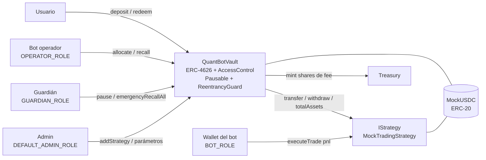

# QuantBot Vaults

**Protocolo de bóvedas automatizadas en Solidity para la ejecución segura de estrategias de trading algorítmico y bots en mercados Fintech on-chain**

> Proyecto Final — Desarrollo Web3 / Solidity (nivel avanzado). Hardhat · OpenZeppelin 5 · ERC-4626 · React + ethers v6.

---

## Tabla de contenidos

1. [Qué hace el proyecto](#1-qué-hace-el-proyecto)
2. [Por qué blockchain](#2-por-qué-blockchain-análisis-de-la-solución)
3. [Arquitectura](#3-arquitectura)
4. [Estructura del repositorio](#4-estructura-del-repositorio)
5. [Instalación y compilación](#5-instalación-y-compilación)
6. [Tests y coverage](#6-tests-y-coverage)
7. [Análisis estático con Slither](#7-análisis-estático-con-slither)
8. [Cómo ejecutar el proyecto (deploy, verificación, demo, frontend)](#8-cómo-ejecutar-el-proyecto)
9. [Red y contratos desplegados](#9-red-y-contratos-desplegados)
10. [Seguridad: decisiones de diseño](#10-seguridad-decisiones-de-diseño)
11. [Limitaciones conocidas del MVP](#11-limitaciones-conocidas-del-mvp)
12. [Roadmap](#12-roadmap)

---

## 1. Qué hace el proyecto

QuantBot Vaults es una **bóveda ERC-4626** donde los usuarios depositan un token (en la demo, `mUSDC`) y reciben *shares*. Un **operador (el bot de trading)** puede asignar parte de ese capital a **estrategias whitelisteadas**, pero el protocolo aplica **límites de riesgo on-chain** que el bot no puede saltarse:

| Control | Qué impide |
|---|---|
| Whitelist de estrategias | El bot no puede enviar fondos a una dirección arbitraria; solo a estrategias registradas por el admin, que además deben usar el mismo activo y apuntar a este vault. |
| Tope por estrategia (`maxAllocationBps`) | Concentrar demasiado capital en un solo bot. |
| Reserva mínima de liquidez (`minIdleBps`) | Dejar el vault sin liquidez para retiros. |
| Circuit breaker (`maxDrawdownBps`) | Seguir asignando a una estrategia que ya perdió más de lo tolerado (cualquiera puede dispararlo, solo reduce riesgo). |
| Pausa / `emergencyRecallAll` (rol guardián) | Daño prolongado ante un incidente: pausa depósitos y recupera todo el capital posible. **Los retiros nunca se bloquean por la pausa.** |
| Fee de performance con *high-water mark* | Cobrar comisión dos veces sobre la misma ganancia o cobrar sobre depósitos nuevos. Se paga acuñando shares al treasury. |
| Tope de depósitos (`depositCap`) | Exposición excesiva durante la fase MVP. |

**Flujo principal (el que se muestra en la demo):**

```
usuario ──deposit──▶ Vault ──allocate (bot)──▶ Strategy
                        ▲                          │ executeTrade(+pnl)  (el bot reporta ganancia)
                        └────── recall ◀───────────┘
usuario ◀─redeem (capital + ganancia − fee)─ Vault          harvest ─▶ mint de shares de fee al treasury
```

---

## 2. Por qué blockchain (análisis de la solución)

Un fondo gestionado por un bot tiene un problema de confianza: el usuario entrega su capital a un tercero y no puede verificar qué hace con él. Blockchain aporta, de forma verificable:

- **Custodia no discrecional:** el operador *nunca* tiene los fondos en su wallet; solo puede moverlos dentro de reglas codificadas (whitelist, topes, reserva de liquidez). Un bot comprometido tiene un radio de daño acotado.
- **Transparencia y auditabilidad:** TVL, asignaciones, pérdidas y comisiones son públicas y trazables por eventos.
- **Retiros garantizados por código:** el derecho a retirar la liquidez disponible no depende de la voluntad del gestor.
- **Composabilidad:** al ser ERC-4626, la bóveda es integrable por otros protocolos, agregadores y frontends sin adaptadores.
- **Comisiones automáticas y justas:** el high-water mark es código, no una promesa contractual.

Lo que **no** resuelve (y se documenta en [limitaciones](#11-limitaciones-conocidas-del-mvp)): el desempeño del bot ocurre parcialmente off-chain, por lo que el protocolo limita el daño posible pero no garantiza rentabilidad.

---

## 3. Arquitectura



**Contratos propios (todos se despliegan y verifican):**

| Contrato | Rol |
|---|---|
| `QuantBotVault` | Núcleo. ERC-4626 + control de roles, límites de riesgo, circuit breaker, pausa, fees. |
| `IStrategy` | Interfaz mínima que cualquier adaptador de estrategia debe cumplir (`asset`, `vault`, `totalAssets`, `withdraw`). |
| `MockTradingStrategy` | Estrategia de demostración: el bot reporta PnL (ganancias aportadas con fondos reales de su wallet; pérdidas enviadas a un sumidero) con tope de pérdida por operación. Representa el "lado off-chain" del bot. |
| `MockUSDC` | Token de prueba con faucet (6 decimales). **Solo testnet.** |

**Interacción entre contratos:** `QuantBotVault` ↔ `MockTradingStrategy` (el vault transfiere fondos, lee `totalAssets()` y llama a `withdraw()`), y ambos con el ERC-20 mediante `SafeERC20`.

**Roles y permisos (documentados también en NatSpec):**

| Rol | Puede | No puede |
|---|---|---|
| `DEFAULT_ADMIN_ROLE` | Registrar/remover estrategias, ajustar parámetros, reanudar (`unpause`). Recomendado: multisig. | Mover fondos de usuarios. |
| `OPERATOR_ROLE` (bot) | `allocate`, `recall`. | Enviar fondos fuera de estrategias registradas; saltarse topes/reserva; pausar/reanudar. |
| `GUARDIAN_ROLE` | `pause`, `deactivateStrategy`, `emergencyRecallAll`, `recall`. | Reanudar el vault, asignar capital. |
| Cualquiera | `harvest`, `checkStrategyHealth` (solo reducen riesgo / cobran fee pendiente). | — |

---

## 4. Estructura del repositorio

```
contracts/
  QuantBotVault.sol            # contrato principal (NatSpec completo)
  interfaces/IStrategy.sol
  strategies/MockTradingStrategy.sol
  mocks/MockUSDC.sol
test/
  QuantBotVault.test.js        # flujo principal, reverts, roles, riesgo, fees, invariante
  MockTradingStrategy.test.js
  MockUSDC.test.js
  helpers/fixture.js
scripts/
  deploy.js                    # despliega y configura roles → deployments/<red>.json
  verify.js                    # verifica en Etherscan e imprime URL del código
  demo.js                      # flujo principal completo on-chain, guarda hashes de tx
frontend/                      # React + Vite + ethers v6
docs/                          # análisis Slither, guion de video, checklist de entrega
```

---

## 5. Instalación y compilación

Requisitos: **Node.js 18+ (recomendado 20 LTS o 22)**, npm.

```bash
git clone <URL_DE_TU_REPO>
cd quantbot-vaults
npm install
cp .env.example .env        # completar solo para desplegar en testnet
npx hardhat compile
```

El compilador es `solc 0.8.24` (optimizer 200 runs, `evmVersion: cancun`). El proyecto debe compilar sin warnings relevantes.

---

## 6. Tests y coverage

```bash
npm test               # todos los tests deben pasar
npm run coverage       # reporte en consola + coverage/index.html
npm run gas            # reporte de gas (opcional)
```

Cobertura de escenarios (3 archivos):

- **Éxito del flujo principal:** depósito → allocate → ganancia del bot → harvest (fee) → recall → redeem con rendimiento.
- **Reverts / errores:** permisos (`AccessControlUnauthorizedAccount`), allocate a dirección no registrada, monto cero, liquidez insuficiente, tope por estrategia, reserva mínima, parámetros inválidos del constructor, tope de depósitos, pausa, estrategia incompatible, `MAX_STRATEGIES`, pérdida por encima del límite.
- **Riesgo:** circuit breaker por drawdown, high-water mark (sin doble cobro), depósito nuevo no se cobra como ganancia, pausa que no bloquea retiros, `emergencyRecallAll`.
- **Invariante:** lo reclamable por todos los holders nunca excede `totalAssets` en una secuencia determinística de operaciones.

> Resultado: 42 tests pasando. Coverage: Statements 97.44 %, Branches 84.88 %, Functions 97.83 %, Lines 97.92 % (detalle en docs/EVIDENCIA.md).

---

## 7. Análisis estático con Slither

```bash
pip install slither-analyzer      # una sola vez
npm run slither                   # = slither . --config-file slither.config.json
```

La configuración (`slither.config.json`) excluye `node_modules` y `contracts/mocks`. El resultado real de la ejecución y la justificación de cada finding está en [`docs/SLITHER.md`](docs/SLITHER.md).

---

## 8. Cómo ejecutar el proyecto

### 8.1 Local (sin testnet)

```bash
npx hardhat run scripts/demo.js          # despliega en la red en memoria y corre el flujo completo
```

### 8.2 Testnet (Sepolia)

1. Completar `.env` (ver `.env.example`): `SEPOLIA_RPC_URL`, `PRIVATE_KEY` (**wallet descartable de testnet**), `ETHERSCAN_API_KEY`.
2. Conseguir ETH de Sepolia en un faucet.
3. Ejecutar:

```bash
npm run deploy:sepolia      # despliega MockUSDC, QuantBotVault, MockTradingStrategy + roles
npm run verify:sepolia      # verifica los 3 contratos e imprime la URL del código verificado
npm run demo:sepolia        # corre el flujo principal on-chain y guarda los hashes
```

`deploy` escribe `deployments/sepolia.json` (direcciones y argumentos de constructor) y `demo` escribe `deployments/sepolia-demo.json` con los hashes y links de cada transacción. **Copiar esos datos a la sección 9 de este README.**

### 8.3 Frontend

```bash
cd frontend
npm install
cp .env.example .env     # pegar las direcciones de deployments/sepolia.json
npm run dev              # http://localhost:5173
```

Desde la UI: conectar wallet → *faucet* → aprobar → depositar → (cuenta con roles de operador/bot) asignar al bot, reportar ganancia/pérdida, harvest, chequear drawdown → retirar. Los botones de operador/bot/guardián se habilitan solo si la cuenta tiene el rol on-chain. Cada transacción muestra un link al explorer.

---

## 9. Red y contratos desplegados

**Red:** Sepolia (chainId 11155111)

| Contrato | Dirección | Código verificado |
|---|---|---|
| MockUSDC | `0xbfB3807973FD1334BcB2B3452C1DB085437f2005` | https://sepolia.etherscan.io/address/0xbfB3807973FD1334BcB2B3452C1DB085437f2005#code |
| QuantBotVault | `0x47853947791FFd06d3046D895A0806deAf58FeD6` | https://sepolia.etherscan.io/address/0x47853947791FFd06d3046D895A0806deAf58FeD6#code |
| MockTradingStrategy | `0xDB609B4e14eeE055d125414B9A05F6D5c0297184` | https://sepolia.etherscan.io/address/0xDB609B4e14eeE055d125414B9A05F6D5c0297184#code |

**Transacciones reales del flujo principal** (salida de `npm run demo:sepolia`):

| Paso | Transacción |
|---|---|
| 1. Faucet de mUSDC | [0x2e8ceab450…](https://sepolia.etherscan.io/tx/0x2e8ceab450afc91bd1b329bfc2794de117dc1ba08e1cf8da104a591a45e55837) |
| 2. Approve del vault | [0xcbfcca8588…](https://sepolia.etherscan.io/tx/0xcbfcca8588bf754715a590d71bcabf603c99b75d84a57056456f1547d72ca7b8) |
| 3. Depósito de 1000 mUSDC | [0xd2f00997b0…](https://sepolia.etherscan.io/tx/0xd2f00997b0f83b0b3e3a7fe57e784d7ba0253d60d6b46ebf554ab4c7c5c93e78) |
| 4. Bot asigna 500.0 mUSDC a la estrategia | [0x5263b46a79…](https://sepolia.etherscan.io/tx/0x5263b46a792964a13cff058a85f6f73e40898e29572572135a3b7643805ccc1c) |
| 5. Approve de la estrategia | [0x15ac4509a9…](https://sepolia.etherscan.io/tx/0x15ac4509a9306352a72fb86647bcfcf6cfb6dd48edb748234c2605967a67afb4) |
| 6. Bot reporta ganancia de +50 mUSDC | [0xbd279ea5a0…](https://sepolia.etherscan.io/tx/0xbd279ea5a001bae23539d6f112109d6fd1231f7b360326edbf66303b83d2200d) |
| 7. Harvest (cobro de fee de performance) | [0x8520caccf2…](https://sepolia.etherscan.io/tx/0x8520caccf2221be249248c708f1ef322b055a4155c647ce330e95793eae91660) |
| 8. Health check de la estrategia (circuit breaker) | [0x89a54008b5…](https://sepolia.etherscan.io/tx/0x89a54008b5dbd0150cb7f854161d9eb9bc009a46803b2cea8cb006f7e61fae5c) |
| 9. Recall de 550.0 mUSDC | [0x6497084747…](https://sepolia.etherscan.io/tx/0x6497084747d4991c3c99509915a080de5dc53ddf8556fa84480334787e64a8c1) |
| 10. Redeem de las shares del depósito | [0xa1cbb31bdf…](https://sepolia.etherscan.io/tx/0xa1cbb31bdf31674ce5f353967b842cf9a99ba9a91688271151739098ba46009f) |

---

## 10. Seguridad: decisiones de diseño

- **Checks-Effects-Interactions** en `allocate` (actualiza `debt` y emite evento antes de `safeTransfer`) y `ReentrancyGuard` en todas las funciones que mueven fondos.
- **`SafeERC20`** en todas las transferencias de tokens.
- **Custom errors** con parámetros (sin strings de error) y **eventos** para toda operación relevante.
- **Mitigación del ataque de inflación del primer depositante** con `_decimalsOffset() = 3` (shares virtuales de OpenZeppelin).
- **Lo recibido en un `recall` se mide por diferencia de balance**, sin confiar en el valor de retorno de la estrategia.
- **Empaquetado de storage:** `StrategyInfo` ocupa un único slot (`bool, bool, uint16, uint128`); `constant`/`immutable` donde corresponde; parámetros en `uint16`.
- **Sin** `tx.origin`, `delegatecall`, `selfdestruct` ni `assembly`. `unchecked` solo en contadores de bucle acotados por `MAX_STRATEGIES`.
- **`emergencyRecallAll`** usa `try/catch`: una estrategia rota no impide recuperar las demás.
- **Los retiros no dependen de `whenNotPaused`**: el usuario siempre puede sacar la liquidez disponible.
- `MockUSDC` y `MockTradingStrategy` son **solo para demostración**; no usar en producción.

---

## 11. Limitaciones conocidas del MVP

1. **Estrategia simulada:** `MockTradingStrategy` no opera en mercados reales; el PnL lo reporta una wallet con `BOT_ROLE`. En producción deben usarse adaptadores a protocolos reales (DEX, lending, perps) cuyo `totalAssets()` se calcule on-chain.
2. **Confianza en el valor de las estrategias:** `totalAssets()` del vault suma el de cada estrategia. Una estrategia mal diseñada que revierta en `totalAssets()` bloquearía operaciones del vault (riesgo acotado por whitelist de admin y `MAX_STRATEGIES = 10`). Mitigación planeada: ver roadmap.
3. **Retiros limitados a la liquidez ociosa:** si el capital está asignado, hay que esperar un `recall`. La reserva mínima mitiga pero no elimina esto.
4. **Admin centralizado:** el rol de admin debe ser un multisig/timelock en producción.
5. **Sin oráculos de precios:** el circuit breaker usa el valor reportado por la estrategia, no un precio externo.
6. **Sin auditoría profesional.** Proyecto académico.
7. El token de la demo (`MockUSDC`) tiene faucet público.

---

## 12. Roadmap

**Fase 2 — Funcionalidad**
- Adaptadores reales: Uniswap v3 (LP), Aave v3 (lending), Aerodrome/GMX (perps), con `totalAssets()` calculado on-chain.
- Integración con **Chainlink** (precios / Automation) para disparar `checkStrategyHealth` y `harvest` automáticamente y valuar posiciones.
- Retiros asíncronos (cola ERC-7540) para estrategias con liquidez diferida.
- Múltiples vaults por activo y *fee on management* opcional.
- Fábrica de vaults (`VaultFactory`) con clones mínimos (EIP-1167) para bots de terceros.

**Fase 3 — Seguridad y escalabilidad**
- Admin detrás de **multisig + `TimelockController`**.
- Manejo robusto de estrategias que fallan: `try/catch` en `totalAssets()`, remoción forzada y valor cacheado.
- Fuzzing e *invariant testing* (Foundry/Echidna) y **auditoría externa**.
- Límites de *slippage* y de volumen por ventana temporal para el operador.
- Despliegue en L2 (Base/Arbitrum/Optimism) para reducir costos de gas del bot.
- Subgraph (The Graph) para analítica histórica (PnL, TVL, drawdown) en el frontend.

---

## Licencia

MIT — ver [LICENSE](LICENSE).
